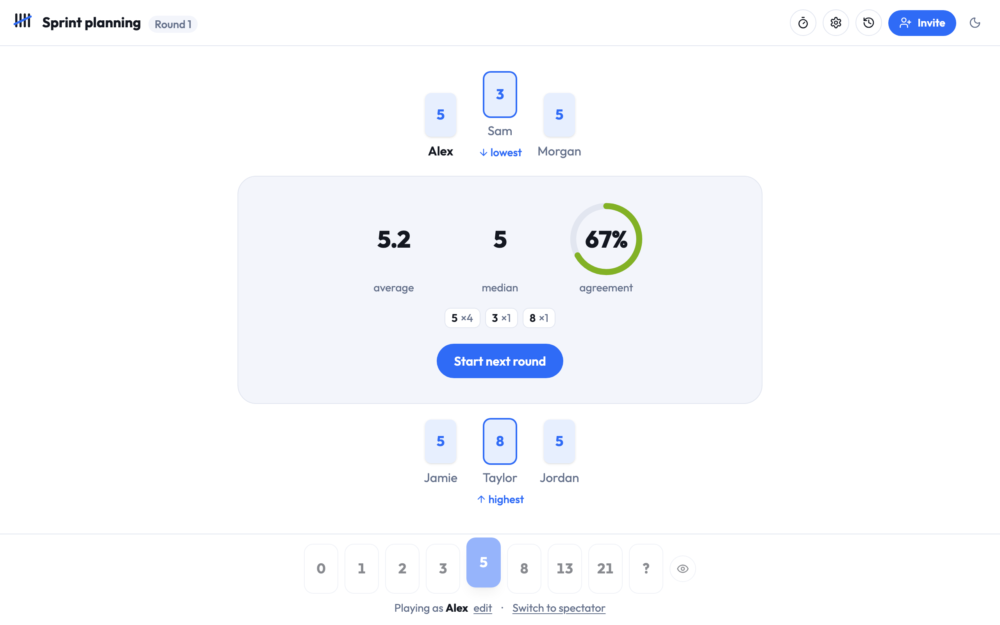

# Tally

Real-time planning poker on the Cloudflare stack. No accounts, no setup: create a
game, share the link, estimate together.



## Stack

- **SvelteKit** (Svelte 5 runes) + **Tailwind v4**, deployed as a single Cloudflare Worker with static assets
- **Durable Objects** for realtime: one room = one `PokerRoom` DO using the WebSocket Hibernation API
- Room state and voting history live in DO storage; rooms expire 30 days after the last activity (alarm-based)

## Architecture notes

- `src/worker.ts` is the real worker entry (see `wrangler.jsonc`): it routes
  `/ws/:roomId` upgrades to the `PokerRoom` DO and delegates everything else to the
  SvelteKit worker.
- adapter-cloudflare writes its generated worker to whatever `main` points to in the
  wrangler config it reads. That's why the adapter gets its own `wrangler.build.jsonc`
  (see `vite.config.ts`), which points `main` at `.svelte-kit/cloudflare/_worker.js`.
- `src/worker.ts` imports the generated worker via the `sveltekit-worker` alias
  (defined in `wrangler.jsonc`) so TypeScript never type-checks the generated build
  output (declared in `src/svelte-worker.d.ts`).
- `src/lib/protocol.ts` holds the shared client/server message types.
- Player identity: the DO issues a `playerId` + `secret` per room, stored in
  localStorage. Stable server-side IDs keep the door open for accounts later (D1).

## Develop

Uses **pnpm**. `worker-configuration.d.ts` is generated, not committed: run `pnpm gen`
after cloning or after changing `wrangler.jsonc`.

```sh
cp .env.example .env
pnpm install
pnpm gen           # generate Env types from wrangler.jsonc
pnpm dev           # vite dev — UI only, no Durable Object (no websockets, no room API)
pnpm preview       # build first, then: full app under wrangler dev on :4173
```

For realtime work use the build + wrangler dev cycle:

```sh
pnpm build && pnpm exec wrangler dev --port 8787
```

## Checks and tests

Tooling is the oxc stack (oxlint + oxfmt, including Tailwind class sorting) and vitest.
The Durable Object tests run inside workerd via `@cloudflare/vitest-pool-workers`
(see `vitest.config.ts` + `wrangler.test.jsonc`).

```sh
pnpm lint          # oxlint + oxfmt --check
pnpm format        # oxfmt
pnpm check         # wrangler types --check + svelte-check
pnpm test          # vitest (unit + DO integration in workerd)
```

## Deploy

Pushes to `main` and pull requests run checks only. Deployments are manual:
in GitHub, open **Actions → CI → Run workflow**, select `main`, and run the workflow.
The workflow runs all checks before deploying with wrangler. Required repo
secrets: `CLOUDFLARE_API_TOKEN` (Workers Scripts:Edit permission) and
`CLOUDFLARE_ACCOUNT_ID`.

For optional PostHog analytics, see [Analytics setup](docs/posthog-setup-report.md).

Manual deploy:

```sh
pnpm build && pnpm exec wrangler deploy
```

## License

Tally is licensed under the [MIT License](LICENSE). Third-party dependencies,
fonts, and icons retain their own licenses.
